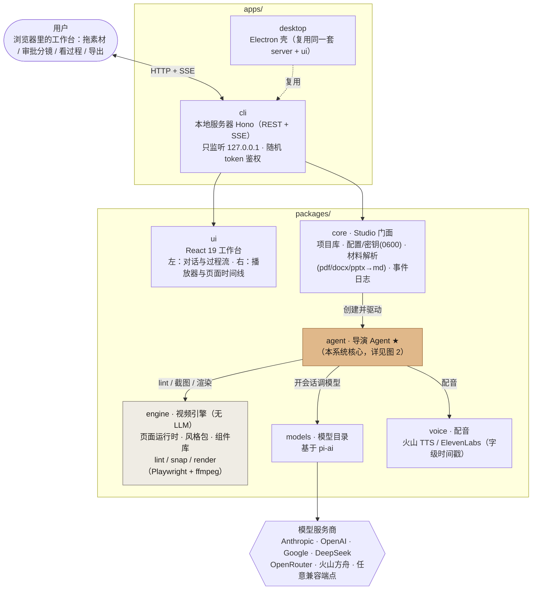
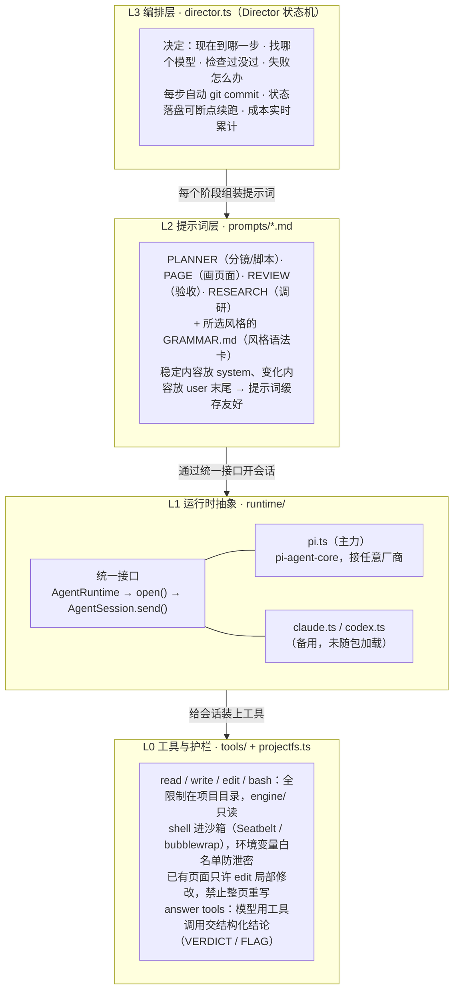
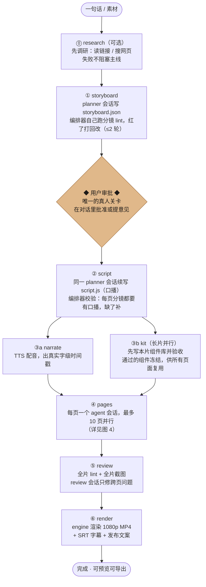
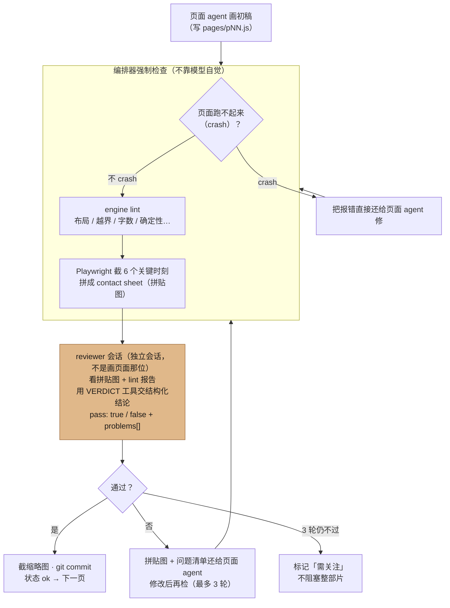
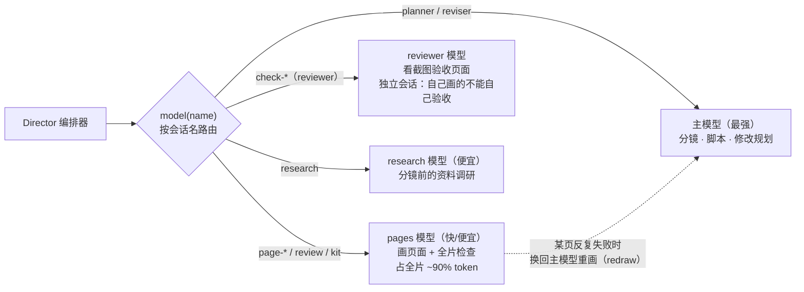
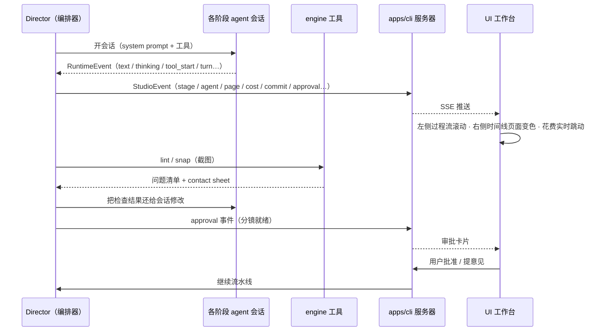
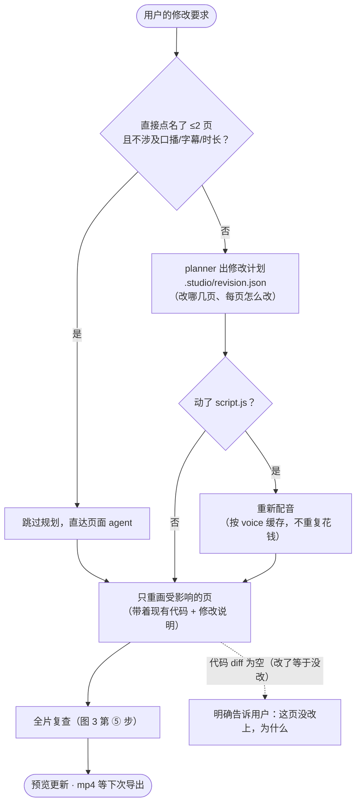

# TimoTV Agent Harness 架构与 Workflow 图解

> 配合 [整体架构说明](timotv-architecture.zh-CN.md) 阅读。本文用图说明整体分层、Agent 内部设计与关键流程。

## 1. 全局架构：从用户到模型的一条竖直调用链

**要点**：`engine` 里没有任何 AI——它是一套成熟的"绘图 + 检查 + 渲染"工具箱。Agent 不凭空生成视频，而是写 JS 页面代码驱动 engine，再由 engine 的工具验收。

---

## 2. Agent 内部四层（packages/agent）

一句话记住四层：

| 层 | 角色 | 职责 |
|---|---|---|
| L3 编排层 | 大脑 | 什么时候做什么 |
| L2 提示词层 | 话术 | 对模型说什么 |
| L1 运行时抽象 | 嘴巴和耳朵 | 跟哪个模型说 |
| L0 工具与护栏 | 手和镣铐 | 能做什么、不许做什么 |

---

## 3. 制作流水线：Director 状态机的一次完整运行

**断点续跑**：每个阶段是独立 agent 会话，状态存在 `.studio/state.json`，会话记录存在 `.studio/sessions/`。中途停止或服务重启后，`run()` 从断掉的阶段继续，不重复花钱。

---

## 4. 核心闭环：一页纸的"画 → 检 → 修"（第 ④ 步内部）

---

## 5. 多模型路由：一次运行最多四个模型分工

**Anthropic 缓存预热**：10 页并行时，第一页先单独跑——等它把超长共享 system prompt 写进 prompt cache，其余 9 页才放行，省下 9 次缓存写入费。（Gemini / OpenAI 缓存免费，直接全并行。）

---

## 6. 事件流：Director 的一举一动如何出现在 UI 上

UI 上看到的每一条消息、每一个工具步骤、每一分花费，都是 `StudioEvent` 的投影——事件流是编排器与界面之间唯一的通道。

---

## 7. 修订流程：片子完成后用户说"改一下第 3 页"

其余一切原样保留：其它页面、分镜、时间线、已渲染的片段。

---

## 设计哲学

**用工程护栏替代模型纪律**：模型只负责写；正确性由编排器通过 lint、确定性检查、截图验收、独立 reviewer、git 快照来保证。再弱一些的模型也能可靠出片。

- **runtime 抽象（L1）** 让"任何模型"成为可能；
- **Director 状态机（L3）** 让流水线可恢复、可观测、多模型各用其长；
- **每一步都是 git commit**，撤销就是 `git revert`；
- **事件流（StudioEvent → SSE）** 让 agent 的每一步对用户透明。
