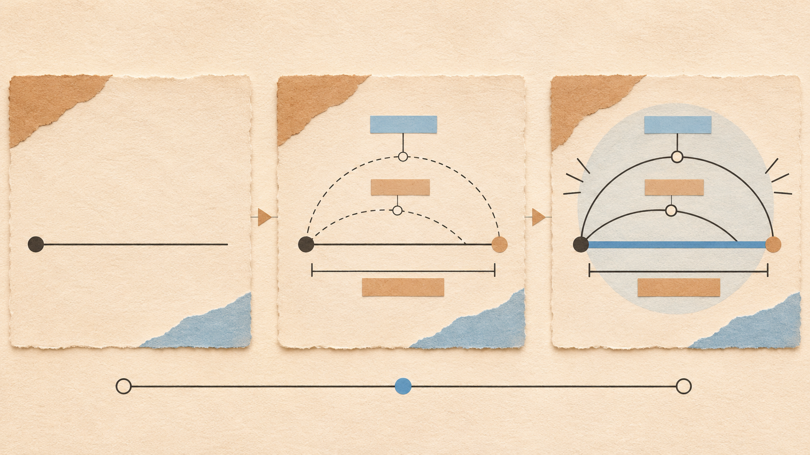
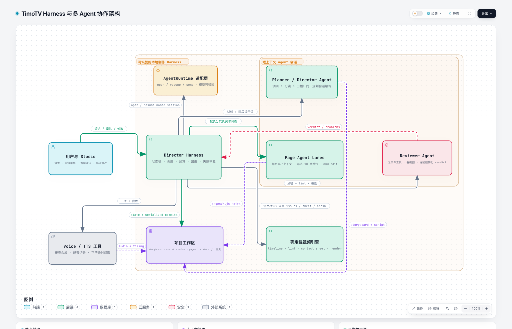
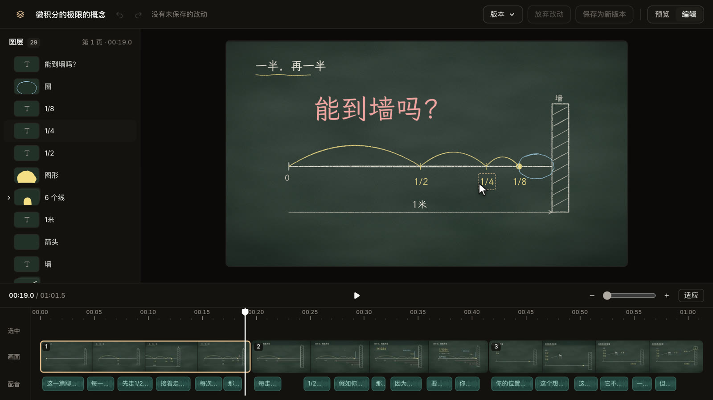

# 视频这活儿，越来越像前端了

## 当视频变成可生成 可检查 可修改的数字产品

这是一份约 45–60 分钟的完整讲稿，面向前端开发者和 AI 应用开发者。TimoTV 是贯穿全文的案例。文章不会做逐文件的源码导读，但会用少量独立代码和提示词示例，把导演、分镜、口播、配音、剪辑以及 Agent 的实际运行方式讲清楚。


## 开场

大家好，今天想聊一个我在做 TimoTV 的过程中越来越强烈的感受：视频这活儿，正在变得越来越像前端。

我说的当然不是“以后所有视频都用网页做”，也不是“前端工程师马上就能取代导演和剪辑师”。我想说的是，一部分视频，尤其是知识讲解、信息可视化和图文动画视频，它们的制作方式正在发生变化。

过去我们很容易把视频理解成一条最终导出的文件。做完，导出，得到一个 MP4，事情就结束了。但在 TimoTV 里，我发现自己关心的问题已经不只是“怎样生成一条视频”。我还会反复问：里面的东西能不能复用？能不能检查？能不能只改一个局部？改坏了能不能恢复？不同页面之间能不能保持统一？用户能不能在生成之后继续接手？

这些问题听上去是不是很熟悉？

它们更像我们做网站和数字产品时会遇到的问题。我们不只关心一个页面第一次长什么样，还关心它的结构、状态、组件、预览、迭代和版本。

所以今天我想讲的核心判断是：

> 当视频不再只是一条导出的 MP4，而是一套可以继续运行和修改的内容系统，前端工程的方法就开始进入视频制作。当这套系统还能观察自己的结果并给出反馈，Agent 才真正有机会参与其中。

## 先看一条视频

在继续解释之前，可以先看一小段 TimoTV 做出来的视频。


这段视频讲的是测不准原理。大家看的时候可以留意三件事：文字和旁白怎样配合，图形怎样随着讲述展开，以及重点为什么会在某个时刻被强调。

现在假设这条片子已经做得差不多了，我只有三个小要求：

第一，这个标签往左一点。

第二，这句话提前半秒出现。

第三，标题换一个颜色。

这三个要求都不大，却很能说明问题。创作真正花时间的地方，经常不是第一次得到结果，而是后面几十次这样的小修改。

如果我们手里只有一条 MP4，这些要求就不容易处理。我们需要回到原始工程，找到对应的轨道、对象和关键帧。如果视频是一次生成出来的，情况可能更麻烦：我们甚至不知道下一次生成会不会把已经满意的地方一起改掉。

所以我后来越来越觉得，评价一个 AI 视频工具，不能只看它第一次生成得多惊艳。还要看生成之后，创作者能不能继续工作。

## MP4 只是最后的结果

观众最后看到的当然是一条视频。但对创作者来说，MP4 只是最终交付物，不应该是唯一留下来的东西。

制作过程里还有内容结构、画面元素、讲稿、声音、时间关系、视觉风格和修改记录。如果这些东西仍然存在，视频就不是一个封死的成品，而是一套可以继续编辑和演化的内容系统。

我很喜欢用一个简单的类比来解释：

> MP4 有点像网站的一张整页截图。它是一个结果，但不是产品本身。

截图可以告诉你网页看起来怎样，却不能让你修改按钮、替换文字、改变状态，也不能说明这个页面在不同条件下怎样变化。同样，一条导出的视频可以播放，却很难回答“第三页的标签在哪里”“这一句话什么时候出现”“这个元素能不能只改颜色”这样的问题。

当然，视频不是网页。网页通常等待用户点击，视频主要沿着时间向前播放；网页的状态变化往往来自交互，视频的状态变化主要来自时间。这个类比不是要抹掉媒介差异，而是说明：成品背后可以保留一套能够持续修改的系统。


## 它为什么开始像前端

具体来说，我觉得至少有五种熟悉的前端工作方式，正在进入这类视频制作。

第一，内容开始由结构和规则组织。

我们不再只看到一条扁平的时间线，而是能识别出页面、标题、注释、图形、讲稿和它们之间的时间关系。结构一旦保留下来，修改就能落到具体对象，而不是笼统地要求“再生成一次”。

第二，视频开始拥有组件和设计系统。

知识视频里会反复出现标题、卡片、图表、人物、注释和转场。如果每一页都从空白画布重新发明，效率会很低，风格也很难稳定。如果它们遵循一套共同的视觉语言，创作者不需要每次从头开始，Agent 也不需要在每一页上凭空猜测什么算“好看”。

这和前端里的组件思想很接近。复用的并不只是一个外观，还包括信息该怎样组织、重点怎样出现、哪些东西可以变化、哪些规则必须保持一致。

第三，状态变化开始驱动画面。

在前端开发里，我们很习惯一句话：界面由当前状态决定。到了视频里，最核心的状态就是时间。

可以把它简化成一个表达：

> 画面 = f（时间）

第四，制作过程可以即时预览。

如果画面由时间状态决定，我们就可以直接跳到某一个时刻查看结果。问题不再是“这条片子好像有哪里不对”，而可以具体到“第三页第 18 秒时，标题和注释重叠了”。能够定位，就能够复现；能够复现，才更容易修改。

第五，视频可以持续迭代。

一处内容可以单独修改，每次保存可以留下历史，改坏了可以恢复。创作者不需要把每一次修改都当成一次冒险，也不需要为了一个小问题重新赌整条片子的生成结果。

这里迁移的不是某个前端框架，也不是把一套网页技术强行套到视频上。真正迁移的是前端开发长期积累的产品工程方法：结构化、组件化、状态驱动、即时反馈和持续迭代。

## 时间就是视频的状态

“画面由时间决定”是整个类比里最关键的一步。



看这三个时刻。第一个时刻，概念刚刚出现；第二个时刻，几个对象之间开始建立关系；第三个时刻，结论被完整地强调出来。

它们不是三张互不相关的图片，而是同一组内容在不同时间上的三个状态。

这个抽象会带来几种很实际的能力。

我们可以跳到问题发生的时刻，不需要从头播放整条视频。我们可以抽取几个关键时刻放在一起比较，看看信息是不是逐步建立，重点有没有在正确的时候出现。修改了内容之后，也可以重新得到一段连续的画面，而不是手工维护很多彼此独立的截图。

不过这里有一个很重要的边界：单帧正确不等于整段视频正确。

一张截图里没有重叠，只能说明那个时刻的布局没有明显问题。它不能证明动画中间没有闪烁，不能证明节奏自然，也不能证明声音和画面配合得好。所以检查关键时刻很有用，但最后仍然要把整条片子从头到尾看一遍。

这也引出了下一个问题：当视频已经变成一套有结构、有状态、能够预览和修改的系统，谁来把它做出来？

## 导演到底在做什么

在讨论 Agent 之前，我们先把“导演”这个词拆开。

很多人第一次让 AI 做视频，会写一句：“帮我把这篇文章做成一条三分钟视频。”模型也许会给出五个标题、六段画面描述和一篇旁白，看上去什么都有。但它通常还不是可以制作的分镜。

问题在于，文章是按照段落组织的，视频是按照观众的注意力组织的。

文章可以让读者停下来回看，视频却会一直往前走。文章可以在一个段落里连续放进三个抽象概念，视频必须决定：这一刻观众到底听什么、看什么，下一秒发生什么变化。

所以导演做的第一件事，不是选一个转场，也不是决定镜头推近还是拉远，而是重新安排观众的认知顺序。

我一般把它拆成四个问题：

1. 观众在开头为什么愿意继续看？
2. 理解结论之前，必须先建立哪个直觉？
3. 哪个关系只靠语言很难说清，必须让画面来承担？
4. 结尾应该留下一个什么动作或判断，而不只是一句口号？

比如“测不准原理”这个主题，最差的做法是先展示定义，再列公式，再放一张总结卡。知识也许没错，但观看体验像一份会自动翻页的 PPT。

导演会换一个顺序：先让观众看到一个具体困难——我们越想把一个粒子的位置钉得准确，它的动量就越难确定；接着用波包变窄和频率范围变宽建立直觉；然后再解释这不是仪器不够精密，而是量子状态本身的结构；最后让两个量的关系在画面中同时收紧，落到结论。

这就是导演和摘要工具的区别。摘要工具问“原文说了什么”，导演问“观众要经历什么，才会真的理解”。

在 Agent 系统里，这一步最好单独完成。它的产物不是成片，而是一份可以讨论、可以检查、可以打回重做的分镜。原因很简单：方向错了，画得越精美，浪费越大。

## 分镜不是一页一句话，而是一串拍点

接下来讲分镜。

传统的简单分镜经常写成这样：

> 第三页：解释位置越准确，动量越不确定。画面展示粒子、波和公式。

这句话对人类导演也许够用，因为人可以靠经验补全大量细节。但对 Agent 来说，它留下了太多没有答案的问题：粒子在哪里？先出现什么？波怎样变化？公式在什么时候出来？旁白说到哪个词时，画面应该强调哪一部分？

所以更适合 Agent 的分镜单位不是“页面描述”，而是“拍点”。

一个拍点至少回答四件事：

- `at`：发生在什么时候；
- `object`：观众正在看哪个具体对象；
- `action`：这个对象发生什么可以看见的动作；
- `text`：屏幕上必须留下什么短文字。

例如可以把其中一页写成：

```json
{
  "id": "p03",
  "section": "越精确，代价越大",
  "say": "先把波包压窄，再让观众看到频率范围同时散开",
  "beats": [
    {
      "at": "c0",
      "object": "横跨画面的蓝色波包",
      "action": "从宽而平缓逐渐向中心收紧",
      "camera": "hold",
      "text": "位置更准"
    },
    {
      "at": "c2:动量",
      "object": "波包下方的一束频率线",
      "action": "向左右迅速散开，覆盖更宽的范围",
      "camera": "push",
      "text": "动量更散"
    },
    {
      "at": "c4",
      "object": "位置范围和动量范围",
      "action": "两者被一条乘号关系连接并同时亮起",
      "camera": "hold",
      "text": "无法同时任意小"
    }
  ]
}
```

这里的 `c0`、`c2` 可以理解为第零句、第二句口播。`c2:动量` 更具体：第二句说到“动量”这个词时，频率线才散开。

这种分镜已经不只是文学描述，它开始接近一个可执行协议。

为什么对象一定要具体？因为“展示核心观点”无法被画出来，“一束频率线向左右散开”可以。

为什么动作不能只写“出现”或“淡入”？因为那只描述了素材怎样上场，没有解释画面如何帮助理解。滚动、聚拢、碰撞、分裂、称重、连接，这些动作本身可以表达关系。

为什么屏幕文字要短？因为观众正在同时听、看和读。把一段旁白原样铺在屏幕上，相当于要求一个人的同一条注意力通道同时做三件事。

一个比较实用的分镜检查表是：

- 每个拍点是否都有具体对象，而不是“卡片”“要点”“内容区”这类版面词？
- 每个拍点是否都有真实动作，而不是“出现”“展示”“依次呈现”？
- 屏幕文字能不能在一眼之内读完？
- 数字能不能在资料或旁白里找到依据？
- 每隔几秒是否真的发生了新的信息变化？
- 开头是否有动作，结尾是否落在动作上，而不是落在居中的金句卡片上？

注意，这些规则不是为了限制导演。它们负责拦住那些已经反复证明会让视频变差的低级模式，把审美判断留给后面的环节。

## Agent 里的提示词到底怎么写

讲到这里，我们终于可以具体谈提示词了。

先说一个结论：复杂 Agent 的提示词，不应该是一句越来越长的咒语，而应该像岗位说明书、接口协议和验收清单的组合。

我会把提示词分成两层。

第一层是稳定的系统提示词。它定义这个 Agent 是谁、负责什么、不负责什么、可以使用哪些工具、产物必须满足哪些规则。比如导演 Agent 只负责调研、分镜和口播；页面 Agent 只负责把一页分镜做成画面；审片 Agent 只负责看结果和提交问题，不允许顺手重画。

第二层是当前任务消息。它只放这一次工作会变化的东西：用户的主题、资料、目标时长、当前页的分镜、已经生成的口播、真实时间点，以及上一轮检查发现的问题。

可以把提示词组装简化成这样：

```ts
const systemPrompt = [
  roleAndResponsibility,
  productionRules,
  visualStyleGrammar,
  availableTools,
  workedExample,
  userPreferences
].join("\n\n");

const taskPrompt = [
  currentGoal,
  relevantMaterials,
  currentPage,
  narrationAndTiming,
  previousCheckResult
].join("\n\n");
```

稳定内容和变化内容分开，还有一个工程上的好处：稳定的长提示词可以被模型服务缓存。十个页面并行制作时，不需要十次重复支付同一份规则和组件说明的完整读取成本。

### 一份导演提示词应该包含什么

如果我们要让 Agent 为“测不准原理”做分镜，可以写成下面这样：

```text
你是一名知识讲解视频导演。你负责把资料组织成可制作的分镜，
而不是直接生成成片，也不是把文章平均切成几段。

目标：
- 面向没有量子力学基础的普通观众
- 时长约 90 秒
- 先建立直觉，再给出概念名称
- 观众看完应能解释：这不是测量仪器不够精密

工作方法：
1. 先阅读提供的资料，列出必须准确表达的事实。
2. 按“钩子—直觉—机制—例子—结论”组织内容。
3. 每页写清主题和若干拍点。
4. 每个拍点必须包含具体对象、可见动作和触发时机。
5. 屏幕文字每项不超过 8 个汉字。
6. 不要用“展示、呈现、依次出现”代替真正的视觉动作。

交付：
- 标题和一句话摘要
- 5 至 7 页分镜
- 每页的讲述目的
- 每页 2 至 4 个拍点
- 需要用户确认的事实或取舍

完成后先停止，等待用户确认分镜，不要继续画页面。
```

这份提示词里最关键的，不是“你是一位世界级导演”。角色扮演可以帮助模型进入语境，但真正决定结果的是后面的任务边界、结构要求和停止条件。

“完成后先停止”非常重要。Agent 的能力越强，我们越需要告诉它什么时候不应该继续。否则它很可能在错误分镜上热情地完成后面所有工作。

### 一份页面提示词应该包含什么

分镜确认后，每一页可以成为一个独立任务。页面 Agent 不需要重新阅读整篇原始资料，也不需要重新决定影片结构。它只需要看到当前页完成工作所需的最小上下文。

```text
把分镜中的第 3 页制作成可播放画面。

本页目的：让观众直观看到位置范围缩小时，动量范围会扩大。

口播与时间：
- 0.00s「如果我们把粒子的位置压得越来越准」
- 3.10s「它的动量范围反而会散得更开」
- 6.45s「两者不能同时被压到任意小」

拍点：
- 第一句开始：蓝色波包从宽到窄
- 说到“动量”时：下方频率线向两边散开
- 第三句开始：两个范围被乘号连接

要求：
- 画面只表达这一组因果关系
- 文字保持简短，不复制整句旁白
- 所有内容避开字幕区域
- 使用已有的影片配色和线条风格
- 修改只发生在这一页

完成初稿后停止，等待截图检查结果。
```

这里可以看到一个非常像前端开发的思想：给组件明确的输入，限定它的职责，让它只修改自己的范围。

### 为什么不要让一个 Agent 从头干到尾

如果同一个对话同时承担调研、导演、写作、配音、绘画和审片，它会遇到三个问题。

第一，上下文越来越长。前面看过的大量资料和中间产物会挤占注意力。

第二，角色会冲突。画页面的人很容易为自己刚刚做出的选择辩护，不适合再充当独立审片人。

第三，失败范围太大。最后画面出错时，我们不知道应该回到分镜、口播、配音还是绘制阶段。

所以更可靠的做法是分阶段开会话，并且每个阶段只开放需要的工具。导演可以读资料和写分镜；页面 Agent 可以读当前页、修改画面和运行预览；审片 Agent 只能看截图并提交结构化结论。

不是模型知道得越多越好。对当前任务来说，知道得刚刚好，通常更可靠。

## 口播怎么写，配音又怎样决定画面

很多视频制作流程把配音当作最后加上去的一条音轨。我更愿意把它看成视频的时间骨架。

先说口播。

适合阅读的文章，不一定适合说出口。文章允许长句、括号、回看和复杂的从句；口播是一条不断消失的声音。上一句话没听懂，下一句话已经来了。

所以口播 Agent 要做的不是把文章缩短，而是把书面逻辑改成听觉逻辑。

几个很实用的原则是：

- 一句话只承担一个主要动作或判断；
- 先说观众已经能看见的东西，再给它命名；
- 数字和结论前留一点空间，不要让信息挤在一起；
- 不要逐字朗读屏幕文字，声音和画面应该互相补充；
- 如果画面需要完成一个动作，在口播之间显式留下停顿。

例如书面表达可能是：

> 海森堡不确定性原理表明，对于某些共轭物理量，例如位置与动量，它们的测量精度存在一个由普朗克常数决定的下界。

适合视频的口播可以拆成：

```text
我们先把粒子的位置压得更准。
波包变窄了。
但与此同时，动量的范围散得更开。
这不是仪器太差。
而是这两个量，本来就不能同时无限精确。
```

这几句话单看没有原句那么“完整”，但它们给画面留下了工作空间。第二句可以对应波包变窄，第三句可以对应频率线散开，第四句给观众一个认知转折。

在结构上，可以把口播保存成一组短句，而不是一整段字符串：

```js
const pages = [{
  id: "p03",
  cues: [
    "我们先把粒子的位置压得更准。",
    { t: "波包变窄了。", hold: 0.4 },
    "但动量的范围反而散得更开。",
    "这不是仪器太差。",
    "而是这两个量不能同时无限精确。"
  ]
}];
```

这里的 `hold: 0.4` 不是为了让数据看起来复杂，而是在告诉系统：这句话说完以后，让画面多停四百毫秒。导演的节奏判断因此变成了可保存、可修改的状态。

### 为什么要先得到真实配音

模型可以估计一句话大概需要几秒，但估计永远不如真实声音。

不同音色、语速、语言和数字读法，都会改变时长。“30%”在不同语言里并不是同样长；同一句中文换一个声音，也可能相差半秒以上。对于短视频来说，半秒已经足够让一个强调动作落错位置。

所以流程应该是：

1. 按页把短句组织成一次自然的朗读；
2. 调用 TTS 得到音频以及词语或字符的时间戳；
3. 在句子之间的真实静音处切分，保留自然停顿；
4. 记录每句声音的起止时间；
5. 再把这些时间交给页面 Agent 安排动画。

配音之后得到的数据，可以简化成这样：

```json
{
  "text": "但动量的范围反而散得更开。",
  "audio": "p03-c2.wav",
  "start": 3.10,
  "duration": 3.02,
  "characters": {
    "动": 3.42,
    "量": 3.55,
    "散": 4.88,
    "开": 5.16
  }
}
```

于是分镜里写的 `c2:动量` 不再是模糊的“差不多这时”，而可以落到真实声音说出这个词的时刻。

这会产生一种很细微、但非常影响质感的同步：旁白说“变窄”时，波包正好收紧；说“散开”时，频率线开始向外扩张；说到“30 年”时，数字正好停在 30，而不是提前把答案放在屏幕上等观众。

### 配音 Agent 实际操作什么

这里也要澄清：TTS 本身不是 Agent。它更像 Agent 使用的一项工具。

Agent 负责的是：选择哪些句子应该连着说，哪里需要停顿，某个专有名词应该怎样读，哪一句需要特殊的语气，以及配音失败或时长异常时应该回到哪里修改。

配音工具负责的是：把文字变成音频，返回时间戳，并尽可能稳定地复用已经生成过的声音。只修改第三页的一句话时，理想状态是只重新生成这句话或这一页，而不是把整条片重新配一遍。

这和前端的数据请求很像：Agent 决定业务意图，工具提供确定能力，缓存避免重复成本。

## 剪辑不是最后一步，而是三次不同的选择

说到剪辑，很多人的第一反应是时间轴、切一刀、加转场。但对知识视频来说，剪辑其实在很早以前就开始了。

我会把它分成三层。

第一层叫内容剪辑。

它发生在分镜阶段。哪些内容删掉，哪些合并，哪个例子提前，哪个概念必须多停留几秒，都属于内容剪辑。这个阶段改动的成本最低，影响却最大。

如果用户说“前半段太学术，希望普通人先看懂直觉”，Agent 不应该只把几个专业词换成口语。它应该回到分镜，调整信息顺序，甚至删掉一页公式，把例子放到定义之前。

第二层叫画面剪辑。

它决定同一句话由什么画面承担、什么时候切页、一个对象是继续留在画面里还是被下一个对象替换。知识视频并不一定需要大量传统镜头切换，但它需要控制视觉焦点。

例如旁白连续说“位置更准，动量更散”。我们可以切成两个镜头，也可以在同一页保留波包，让下方的频率线接着展开。后者让观众看到两个量同时存在，更适合表达它们之间的关系。

第三层叫时间剪辑。

它发生在真实配音已经生成之后。我们会处理句子之间的停顿、动画的起止、重点停留多久、转场是否抢话，以及某个元素究竟提前还是延后半秒。

如果把它写成一个极简的时间驱动画面，大概是这样：

```js
function renderFrame(time, cues) {
  const waveWidth = animate({
    from: 900,
    to: 280,
    start: cues[0].start,
    duration: 1.2
  }, time);

  const momentumSpread = animate({
    from: 160,
    to: 760,
    start: cues[2].characters["动"],
    duration: 0.8
  }, time);

  drawWavePacket({ width: waveWidth });
  drawMomentumLines({ spread: momentumSpread });
}
```

它说明了一件很关键的事：剪辑结果不一定要以一条已经烧死的像素流存在。它也可以是一组素材、对象、时间参数和渲染规则。

这样一来，“这句话提前半秒”就不再意味着重新生成整条视频。它可能只是修改一个时间参数；“标题换成蓝色”只是修改一个样式状态；“标签往左一点”只是修改对象的位置。

### Agent 怎样执行一次剪辑修改

假设用户说：“第三页太快了，波包收紧以后多停一下，再讲动量。”

Agent 首先要判断这是哪一层修改。

它没有改变影片观点，也没有改变页面之间的顺序，所以不必重做整份分镜。它改变了本页口播之间的停顿和动画节奏，因此需要修改口播节拍，重新生成这一页配音，再让这一页画面读取新的时间。

一次合理的操作链可能是：

```text
用户要求
  ↓
判断影响范围：第三页，口播节奏 + 页面时间
  ↓
在“波包变窄了”之后增加 0.6 秒停顿
  ↓
只重新生成第三页声音
  ↓
取得新的句子和字符时间戳
  ↓
重新检查第三页的关键时刻
  ↓
确认无重叠、无越界，再替换成片中的第三页
```

这就是结构化视频比“一次生成一条新视频”更适合 Agent 的地方。Agent 不只是理解自然语言，还能把自然语言映射到明确对象、明确阶段和有限修改范围。

## 一条片在 Agent 里怎样真正跑起来

现在把导演、分镜、配音和剪辑连起来看。



*图：Director Harness 负责状态机、阶段路由、预算和失败恢复；Planner、Page Agent 与 Reviewer 只在各自的短上下文会话中完成专业任务。配音工具、确定性视频引擎和项目工作区提供可执行、可检查、可恢复的生产环境。*

这张图里最重要的节点不是某一个 Agent，而是中间的 Director Harness。用户请求先进入 Harness，再由它按照当前阶段选择 Planner、Page Agent、Reviewer 或确定性工具。Agent 之间不是自由聊天，而是通过项目状态、结构化产物和明确的 verdict 交接工作。

整个流程可以写成一台状态机：

```ts
async function makeFilm(project) {
  if (project.stage === "research") {
    await researchMaterials();
    project.stage = "storyboard";
  }

  if (project.stage === "storyboard") {
    await director.createStoryboard();
    project.stage = "approval";
  }

  if (project.stage === "approval") {
    await waitForHumanDecision();
    project.stage = "script";
  }

  if (project.stage === "script") {
    await director.writeNarration();
    project.stage = "voice";
  }

  if (project.stage === "voice") {
    await voiceTool.synthesizeWithTimestamps();
    project.stage = "pages";
  }

  if (project.stage === "pages") {
    await Promise.all(pages.map(drawAndCheckPage));
    project.stage = "review";
  }

  if (project.stage === "review") {
    await reviewWholeFilm();
    project.stage = "ready";
  }
}
```

这个例子最重要的地方不是语法，而是每一步都有清楚的进入条件和退出产物。

- 调研阶段产出有来源、可画出来的事实；
- 分镜阶段产出拍点结构；
- 真人确认是高价值闸门；
- 口播阶段产出短句；
- 配音阶段产出音频和真实时间；
- 页面阶段产出可以独立预览和修改的画面；
- 审片阶段只处理跨页一致性和明显缺陷。

如果程序中途停止，状态仍然知道已经做到哪里。下次可以从断点继续，而不是从头再做一次。某一页失败，也只需要重跑那一页。

### 页面 Agent 的检查循环

页面 Agent 完成初稿以后，不会因为它说“完成了”就直接相信它。

系统会先运行确定性检查，例如：内容是否跑出画面、是否压住字幕区、文字是否重叠、字号是否过小、相同时间渲染两次是否得到相同结果。

接着，系统在几个关键时刻截图，拼成一张接触表。一个没有参与绘制的审片 Agent 根据分镜、口播和截图判断：画面对不对、有没有画完、重点是否清楚、画面是否真的在解释，而不是堆文字。

检查结果不会只说“不够好看”，而会变成可执行的问题：

```json
{
  "pass": false,
  "problems": [
    {
      "at": 4.9,
      "what": "动量范围的线与字幕区域重叠",
      "fix": "整体上移，并缩短最外侧两条线"
    },
    {
      "at": 6.5,
      "what": "结论文字先于乘号关系出现",
      "fix": "把结论延后到两个范围连接之后"
    }
  ]
}
```

这些问题连同截图一起交回原来的页面 Agent。它只修改具体位置、尺寸或时刻，然后系统再次截图检查。

```ts
for (let round = 1; round <= 3; round++) {
  const result = await checkPage({
    lint: true,
    deterministic: true,
    screenshots: keyMoments
  });

  const verdict = await reviewer.inspect(result);
  if (result.errors.length === 0 && verdict.pass) break;

  await pageAgent.editOnly({
    errors: result.errors,
    problems: verdict.problems,
    screenshots: result.sheet
  });
}
```

为什么强调 `editOnly`？因为局部修改比推倒重来更可靠。一次全量重写很可能修好一个重叠，又改变已经满意的布局、颜色和节奏。Agent 要学会的不是“每次重新交一份作品”，而是像工程师一样维护已有作品。

### 提示词、工具和程序各自负责什么

这里可以总结出一条很重要的技术边界。

提示词负责表达软规则：什么算讲清楚，怎样组织叙事，这个风格应该给人什么感受。

工具负责提供行动能力：读资料、写分镜、生成配音、渲染截图、修改页面。

普通程序负责硬约束：字段是否完整、元素有没有越界、时间是否合法、同一帧能否稳定复现、当前阶段是否允许继续。

不要把所有可靠性都寄托在提示词上。提示词里写十遍“请不要让文字越界”，也不如程序真的测量一次文字边界。

反过来，程序可以检查文字有没有越界，却很难单独判断这个比喻是否准确、这一页是否无聊、观众是否已经失去注意力。那仍然需要模型和人。

这三者不是互相替代，而是分工：

> 模型处理含义，工具连接世界，程序守住底线，人做最终判断。

## Agent 不是一个生成按钮

很多 AI 产品最容易让人看到的，是一个输入框和一个生成按钮。用户输入一句话，模型返回一个结果。这种交互很适合展示模型能力，却不一定适合完成真正复杂的工作。

从一份资料到一条视频，中间至少包含几种不同的任务：理解材料、确定主题、规划分镜、写讲稿、生成声音、组织画面、检查结果、修正问题，最后还要完成发布前的调整。

如果把这些事情一次性交给模型，输入会越来越长，任务边界会越来越模糊。一旦失败，也很难知道是哪一步出了问题。

TimoTV 采用的是分阶段的工作方式。

先从想法或资料出发，规划内容和分镜。分镜先交给用户确认，因为内容结构一旦错了，越早生成精美画面，后面的返工成本越高。

方向确认之后，再写讲稿并生成声音。声音提供了真实的时间依据，画面才知道一句话实际会讲多久，重点应该在哪个时刻出现。

接下来逐页完成画面。一次只处理一页，输入更清楚，修改范围也更小。某一页失败，不需要推翻整条片子；某一页需要重做，也不会天然影响其他已经满意的页面。

页面完成后，还要观察结果。系统在若干关键时刻检查实际画面，发现越界、重叠、缺失或视觉上的问题，再把这些问题交回去修改。

这里最重要的不是“用了几个 Agent”，而是工作怎样被拆开。每一步读什么，产出什么，怎样判断可以继续，这些边界比一个听起来很强的 Agent 名字更重要。

## 让作品自己提供反馈

我认为 AI 应用里一个常被低估的问题是：模型做完以后，怎样知道自己做得对不对？

如果一个 Agent 只能不断输出，却看不到结果，它很难真正完成工作。它更像一个只会交稿、不会校对的人。

所以我们需要一个反馈闭环：

1. 生成初稿。
2. 观察实际结果。
3. 指出具体问题。
4. 局部修改。
5. 再次观察。

反馈一定要足够具体。

“再好看一点”不是很有用的反馈。它没有说明发生了什么，也没有告诉执行者下一步应该改哪里。

“第三页标题和注释重叠”“右侧重点出现得太晚”“图里表达的关系和讲稿不一致”，这些反馈才更容易转化为行动。它们指出了位置、对象和问题类型。

这套思路并不只适用于视频。对很多 AI 产品来说，可靠性都不只来自模型能力，也来自模型所在的工作环境：任务有没有边界，结果能不能观察，问题能不能反馈，修改能不能局部发生。

一个更强的模型当然有价值。但如果没有反馈，它仍然可能稳定地做错；一个稍弱的模型，如果身处一套边界清楚、可以观察和返工的工作流里，反而可能更接近真正可用的产品。

## 生成之后 人才刚刚接手

讲到这里，很容易产生一个误解：既然 Agent 可以规划、生成和检查，人是不是只要在最后点一下“通过”？

我不这样看。

人在这套流程里负责的不是机械审批，而是内容判断、审美取舍和最后的精确控制。

分镜阶段，人要判断什么值得讲，顺序是否成立，哪些重点应该保留。制作过程中，人会发现一些很难写成规则的东西：某个画面虽然没有错误，但太挤；某个转场虽然正常，却抢走了注意力；某个比喻虽然准确，却不适合这批听众。

到了最后，人还需要完成那些很小、却直接影响成片质感的调整。



比如把标签往左一点，修改一个词，换一个颜色，或者让一个元素提前半秒出现。小改动可以直接完成，更复杂的意图可以重新交给 Agent。每次保存留下历史，需要时还能恢复到之前的版本。

这件事对 AI 产品非常重要：

> 让人容易修改，不是生成能力之外的附属功能。它决定了创作者是否敢把真实工作交给 AI。

如果生成结果不能接管，用户就只能在“全部接受”和“全部重来”之间选择。这样的系统可以给人惊喜，却很难承载严肃工作。

真正有用的人机协作，应该允许控制权在双方之间来回流动。Agent 做大量执行，人做关键判断；人完成一个精确修改，Agent 在后续工作里继续尊重它；人发现方向不对，也能回到更早的阶段重新选择。


## 这种方式适合什么

到这里需要主动给标题加一个边界。“视频越来越像前端”是从特定实践里得到的观察，不是对整个影视行业的判断。

它比较适合知识讲解、课程、信息图、数据解释和概念动画。这些内容主要依赖文字、图形、旁白和明确的信息结构，也往往需要统一风格、批量生产和反复修改。

它也比较适合那些会持续演化的内容。课程可能更新，数据可能变化，同一个主题可能需要横版、竖版或不同语言。如果视频背后保留了结构，修改和复用就会更有价值。

但它不适合概括所有视频创作。

真人表演依赖演员、摄影和现场调度；纪录片里有大量无法预知的真实素材；复杂三维特效和逐帧动画有自己的专业流程；有些艺术创作的目标本身就是持续探索，无法提前结构化。

工程化也有代价。组件和规则能够提高稳定性，却可能让形式趋同。自动检查可以发现部分问题，却不能证明内容一定正确，也不能替代叙事和审美判断。我们需要的是更可靠的创作工具，不是把所有创作压进同一种模板。

## 最后回到那三个小修改

现在回到开场的三个要求：标签往左一点，这句话提前半秒，标题换一个颜色。

如果一条视频能够理解这样的要求，准确定位对象，立即看到结果，保存修改，并且随时恢复，那么它已经不太像一个一次性交付的文件，而更像一个持续迭代的数字产品。

这就是我说“视频越来越像前端”的真正含义。

不是因为它用了某个框架，不是因为浏览器能够画画面，也不是因为前端工程师掌握了一个新的输出格式。

而是因为视频开始拥有结构、状态、反馈和迭代。

对 AI 产品来说，这四样东西可能也比“一次生成得有多惊艳”更重要。因为惊艳决定用户愿不愿意试一次，而结构、反馈和可修改性决定用户愿不愿意把真实工作放进来。

如果要把今天的内容压缩成三个可以带走的做法，我会留下这三句：

1. 让生成结果保持结构，而不只留下最终文件。
2. 让系统能够观察结果，并给出足够具体的反馈。
3. 让人能够局部接管、自由尝试，并且随时恢复。

当这些能力同时存在时，Agent 才不是一个偶尔带来惊喜的生成按钮，而可能成为真正参与工作的人。

谢谢大家。

---

## 问答备忘

### 这是不是把网页录成视频

更准确地说，是把视频组织成一套可以持续运行和修改的内容系统，再输出成观众熟悉的视频。浏览器只是实现这种系统的一种方式，不是核心观点。

### 和直接生成视频有什么不同

这套方式优先追求文字、布局、节奏和局部修改的可控性。直接生成的图片或视频也可以成为其中的素材。两者解决的问题不同，没有必要在缺少同题比较时判断谁全面优于谁。

### 为什么需要 Agent

从资料到视频包含规划、写作、画面组织、检查和修正等多步工作。Agent 的价值是跨越这些步骤，并在得到反馈后继续行动，而不只是调用一次生成模型。

### 自动检查能保证质量吗

不能。自动检查可以降低明显错误的概率，最终仍然要检查内容、节奏、声音、审美和整体表达。关键时刻的截图也不能替代完整播放。

### 前端开发者真的能做视频吗

前端开发者熟悉结构化内容、组件、状态、预览和迭代，这些经验很有价值。但视频还要求理解叙事、节奏、声音和镜头。可以迁移的是工程方法，不是全部专业能力。

### 现场演示建议

如果这份文档用于线下分享，演示只需要围绕同一个案例完成三件事：播放一段成片；展示一次具体问题的检查与修正；完成一次小范围人工修改。AI 修改建议使用录屏，移动元素、改字和版本恢复可以现场完成。
